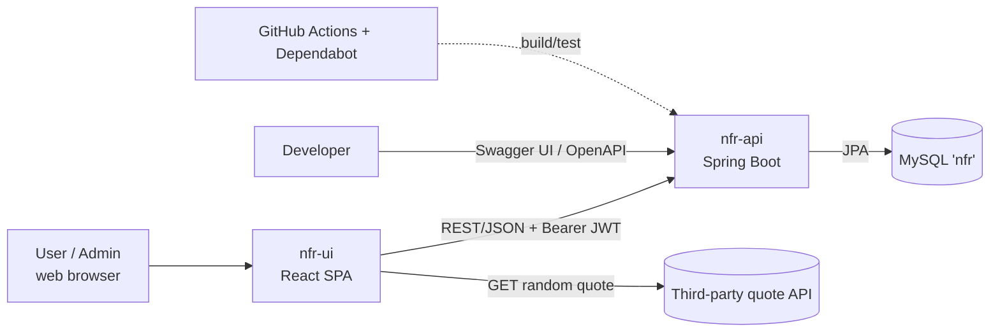
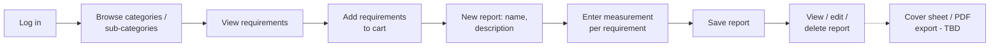

# NFR Report Builder: System Design (High Level)

> NFR Report Builder is Mike Dodds's personal project, built to get hands-on experience with a React front end and a Spring Boot back end.

**Status:** Draft outline, October 2026. **Author:** Mike Dodds
**Sources:** `mdodds2/nfr-api` (`develop` @ 0b2d69d), `mdodds2/nfr-ui`, and the live MySQL schema dump of 2026-10-16. **[TBD]** marks anything the sources don't settle.
**Companion:** [technical-design.md](technical-design.md) has the detail.

## 1. Purpose & Scope
- **Why it exists:** a personal learning project for Mike Dodds, built to get hands-on experience with a React front end and a Spring (Spring Boot) back end. It isn't a commercial product and has no external customers or SLAs.
- **What it does:** NFR Report Builder keeps a catalogue of non-functional requirements organised by quality **Category → Sub-category**. The UI imagery follows ISO/IEC 25010 characteristics such as Performance Efficiency, Security, Reliability and Maintainability.
- Users browse and author requirements, collect them in a "cart", and build **Reports** for a system, with a **Measurement** per requirement (target/threshold, stimulus, context, response, acceptance criteria).
- In scope: the React web UI (`nfr-ui`), the Spring Boot REST API (`nfr-api`) and the MySQL database.
- Out of scope:
  - the third-party "quote of the day" API that the UI calls directly;
  - production hosting, availability/uptime targets, and commercial operation. Deployment is future work (see §8 and §12).

## 2. Stakeholders & Users
| Stakeholder | Interest |
|---|---|
| Mike Dodds | Developer, architect and primary user. Designs, builds and maintains both repos; uses Swagger UI for the API |
| User (`USER` role) | Role supported by the app: self-registers, browses and authors requirements, builds and edits their own reports |
| Administrator (`ADMIN` role) | Role supported by the app: everything a user can do, plus listing all users and all reports, and the admin page |

There are no external customers, sponsors or service-level agreements.

## 3. Context Diagram

## 4. Architecture Overview
- **React UI:** a single-page app built with Vite. It handles navigation, forms and the report "cart", and talks to the API over REST.
- **Spring Boot API:** a stateless REST service. Code is organised by feature (authentication, categories, requirements, reports, users), each with a controller → service → repository flow and DTO mapping. One server-rendered HTML page (report cover sheet) is still a placeholder.
- **MySQL:** a single relational schema `nfr` holding users, categories, sub-categories, requirements, reports, report↔requirement links and measurements. Referential integrity is enforced in the database:
  - Deleting a user removes their reports.
  - Deleting a report removes its measurements.
  - A requirement that has measurements can't be deleted.
- Integration style: synchronous HTTP/JSON with no messaging or caching layer. The API is stateless (JWT), so it could scale horizontally if that were ever needed. Scaling isn't a goal for this project.

## 5. Tech Stack Summary
| Area | Choice |
|---|---|
| Backend | Java 17, Spring Boot 3.5 (Web, Data JPA, Security, Validation, Actuator), jjwt, MapStruct, Lombok, springdoc-openapi |
| Database | MySQL (test builds use in-memory H2 in MySQL mode) |
| Frontend | React 19, React Router 7, Vite 7, JavaScript (no TypeScript) |
| Build / CI | Maven wrapper, JaCoCo coverage gate, GitHub Actions, Dependabot |
| Hosting | Runs locally today; hosting is future work |

## 6. Key Flows (High Level)
**Login**
1. The user submits email and password.
2. The API verifies them and returns a short-lived access token (1 h). It also sets a long-lived refresh cookie (7 d).
3. The UI stores the access token and sends it on every request.
4. Today the UI never uses the refresh cookie, so users must log in again after an hour.

**Build a report**

## 7. Security Approach (High Level)
- Stateless token authentication (JWT). Passwords are hashed with BCrypt. There are two roles: `USER` and `ADMIN`.
- Public endpoints: login, refresh, registration and API docs. Everything else requires a token. A few listing endpoints are admin-only.
- The browser keeps the access token in local storage. The refresh token is an HttpOnly, Secure cookie.
- Cross-origin access is limited to the local dev UI origin.
- Known weaknesses are listed in §11: users aren't restricted to their own data, refresh isn't wired up, and tokens are exposed to XSS.

## 8. Deployment & CI/CD Overview
- **API CI:** GitHub Actions runs `./mvnw -B verify` (build, tests, JaCoCo gate) on pushes and PRs to `develop` and `main`, and publishes the coverage report.
- **Dependency updates:** Dependabot checks Maven weekly and GitHub Actions monthly, targeting `develop`.
- **Roadmap** (`docs/ci-cd.md`): branch protection and rulesets, CodeQL, container images on GHCR, and deployment environments.
- **UI:** no CI or Dependabot yet.
- **Runtime:** runs on a local dev machine today (UI on Vite's dev server, API on `:8080`, local MySQL). Hosting, environments, containers and how the UI would be served are future work, not current requirements.

## 9. Quality Attributes (NFRs of this System)
As a personal project, it has no contractual targets. The "Target" column records Mike's own goals where they exist.

| Attribute | Current position | Target |
|---|---|---|
| Security | JWT, BCrypt, role checks, restrictive CORS | **[TBD]** |
| Maintainability | Feature-sliced code, DTO mapping, coverage gate (80% line / 90% branch), Dependabot | Keep the gate |
| Testability | Unit and slice tests per feature; tests run on H2 instead of real MySQL | **[TBD]** |
| Performance / scalability | Stateless API; list endpoints have sorting but no pagination | No formal targets |
| Availability / backup | Single local DB | Out of scope (no SLA); revisit if deployed |
| Observability | Actuator is on the classpath but not configured | **[TBD]** |
| Usability / accessibility | Grid and list views | **[TBD]** |

## 10. Key Decisions
1. SPA plus REST API, kept separate from each other.
2. Stateless JWT with a refresh cookie, rather than server sessions.
3. Feature-based packages, with each feature contributing its own security rules.
4. MySQL as the runtime database with H2 for tests, rather than Testcontainers.
5. Schema managed through hand-maintained SQL, with no migration tool.
6. React Router loaders/actions and Context for state, with no global store or query library.
7. CI first, with incremental hardening as set out in `docs/ci-cd.md`.

## 11. Risks & Known Gaps
| Risk / gap | Impact |
|---|---|
| No per-owner authorization on reports and users | Any logged-in user can apparently edit or delete others' data |
| Refresh flow not wired up in the UI; CORS doesn't allow credentials | Forced re-login every hour |
| Access token in localStorage | Exposed to XSS |
| Validation limits wider than DB columns (report name, measurement fields); constraint violations return 500, not 409; no migrations (repo SQL scripts match the live schema) | Confusing errors and setup that can't be reproduced |
| Inconsistent error responses; UI ignores API errors | Poor user experience and hard debugging |
| Hard-coded API URL and DB credentials | Needs to be externalised before any future deployment |
| UI has no tests or CI | Regressions go unnoticed |
| Forgot-password and cover sheet/PDF export are stubs | Features look available but don't work |

## 12. Roadmap
1. **Hardening:** ownership checks, the refresh flow, consistent errors, and externalised configuration.
2. **Data:** adopt Flyway with the live schema as the baseline, and align validation with column sizes and map constraint violations to 409.
3. **Delivery (future):** UI CI, branch protection and CodeQL, then containers and deployment environments if Mike decides to host it, following `docs/ci-cd.md`.
4. **Features:** forgot-password and report export (cover sheet/PDF).
5. **AI feature: "NFR assistant"** (proposal).
   - Suggests well-formed requirements and measurement fields from a system description and the chosen sub-category.
   - Flags requirements that are vague or untestable.
   - Drafts a report from the cart.
   - Runs server-side behind the API, never directly from the browser.
   - Output is saved as `DRAFT` and needs human approval. Usage is rate-limited and access is by role.
   - **[TBD]** Model and provider, cost, and data-handling policy.
