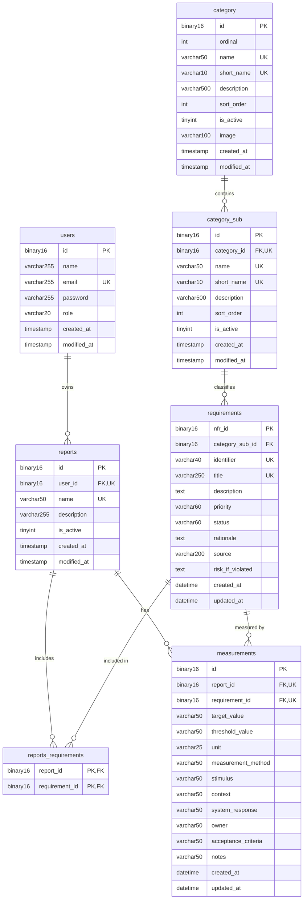
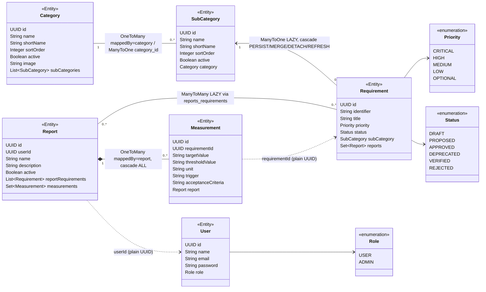
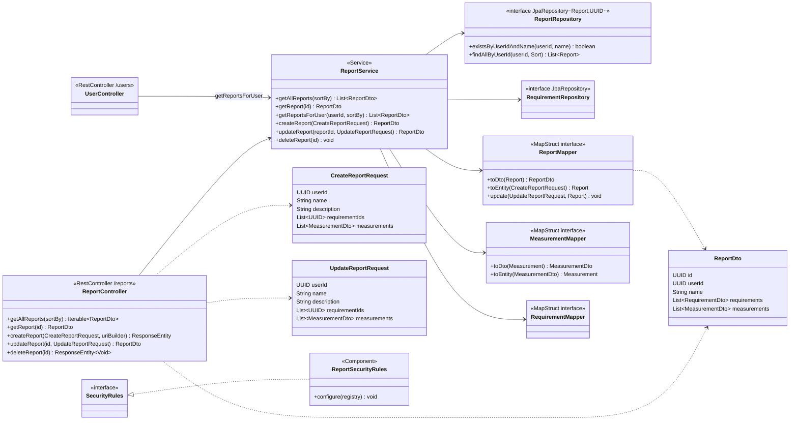
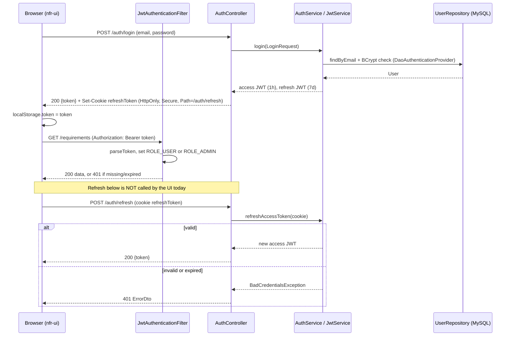

# NFR Manager: Technical Design (Detailed)

**Status:** Draft outline, October 2026
**Sources:** `mdodds2/nfr-api` (`develop` @ 0b2d69d), `mdodds2/nfr-ui`, and Mike's live MySQL schema dump of 2026-10-16. The live schema is authoritative; the repo's `src/main/resources/database/*.sql` scripts match it as of `develop` @ 0b2d69d, apart from the minor differences in §3.3.
**Companion:** [system-design.md](system-design.md). **[TBD]** marks anything that couldn't be determined.

## 1. Package / Module Structure
**nfr-api** (base package `org.dodds.nfrapi`, entry point `NfrApiApplication`)
| Package | Contents |
|---|---|
| `authentication` | `AuthController`, `AuthService`, `JwtService`, `Jwt`, `JwtConfig`, `JwtAuthenticationFilter`, `SecurityConfig`, `AuthSecurityRules`, `LoginRequest`, `LoginResponse`, `JwtResponse` |
| `category` | `Category`, `SubCategory`, controller/service/repositories, `CategoryMapper`, DTOs, request records, and the exceptions `CategoryNotFound`, `SubCategoryNotFound`, `DuplicateCategory`, `DuplicateSubCategory` and `CategoryException` |
| `requirement` | `Requirement`, controller/service/repository, `RequirementMapper`, `RequirementDto`, `NextIdentifierDto`, requests, `RequirementSecurityRules`, exceptions |
| `report` | `Report`, `Measurement`, controller/service/repository, `ReportMapper`, `MeasurementMapper`, DTOs, requests, `ReportSecurityRules`, exceptions |
| `users` | `User`, `Role`, controller/service/repository, `UserDetailsServiceImpl`, `UserMapper`, `UserDto`, requests, `UserSecurityRules`, exceptions |
| `common` | `GlobalExceptionHandler`, `ErrorDto`, `SecurityRules` (interface), `SwaggerSecurityRules`, `CustomCorsConfiguration`, `CoverSheetController`, `Priority`, `Status` |

Resources: `application.yaml`, `database/*.sql` (match the live schema, see §3.3), `templates/coversheet.html`, `static/initech.*`.

**nfr-ui** (`src/`): `pages/` (route screens), `components/` (feature components), `ui/` (presentational primitives), `store/` (contexts), `hooks/`, `util/` (`auth.js`, `http.js`, `constants.js`), `assets/`. Leftover files: `backup/`, `TestPage.jsx`, `index copy.css`.

## 2. Domain Model
- **Category** has many **SubCategory** (`Category.subCategories` `@OneToMany(mappedBy="category")`; `SubCategory.category` `@ManyToOne` with join column `category_id`).
- **SubCategory** has many **Requirement** (`Requirement.subCategory` `@ManyToOne(LAZY)` on `category_sub_id`).
- **Report** ↔ **Requirement** is many-to-many through `reports_requirements` (`Report.reportRequirements` `@ManyToMany(LAZY)` with `@JoinTable`; inverse side `Requirement.reports`).
- **Report** has many **Measurement** (`@OneToMany(mappedBy="report", cascade=ALL, LAZY)`). `Measurement.requirementId` is a plain `UUID`, not a JPA relationship.
- **Report.userId** is a plain `UUID`. No `User` association is mapped.
- **Enums:**
  - `Priority`: CRITICAL, HIGH, MEDIUM, LOW, OPTIONAL
  - `Status`: DRAFT, PROPOSED, APPROVED, DEPRECATED, VERIFIED, REJECTED
  - `Role`: USER, ADMIN
  - All are stored as strings (`@Enumerated(STRING)`).
- **Requirement identifiers:** `Requirement.identifier` (e.g. `NFR-SEC-017`) is suggested by `GET /requirements/nextIdentifier/{categoryId}/{subCategoryId}`.
- **Timestamps:** set by the database (`insertable=false, updatable=false`).

## 3. Data Model
Source: **Mike's live MySQL schema dump of 2026-10-16 (~9:54 AM ET)**. The repo scripts match it as of 0b2d69d (§3.3).

Composite UK markers: `category_sub` (category_id, name) and (category_id, short_name); `reports` (user_id, name); `measurements` (report_id, requirement_id).

### 3.1 Constraints (live schema, 2026-10-16)
| Table | Constraint | Definition |
|---|---|---|
| category | `uq_category_name`, `uq_category_short_name` | UNIQUE(name), UNIQUE(short_name) |
| category_sub | `uq_category_sub_name`, `uq_category_sub_short_name` | UNIQUE(category_id, name), UNIQUE(category_id, short_name) |
| category_sub | `fk_category_id` | category_id → category(id) |
| requirements | `fk_nfr_category_sub`; UNIQUE identifier, title | category_sub_id → category_sub(id) |
| reports | `uq_reports_user_name` | UNIQUE(user_id, name), also serves as the index for the FK |
| reports | `fk_reports_user_id` | user_id → users(id) **ON DELETE CASCADE** |
| users | `u_users_email` | UNIQUE(email) |
| reports_requirements | PK(report_id, requirement_id) | both FKs **ON DELETE CASCADE** |
| measurements | `uq_measure_report_requirement` | UNIQUE(report_id, requirement_id), at most one measurement per requirement per report |
| measurements | `fk_measure_report_id` | report_id → reports(id) **ON DELETE CASCADE** |
| measurements | `fk_measure_requirement_id` | requirement_id → requirements(nfr_id), **no cascade (deliberate)**. Deleting a requirement that has measurements is blocked. |

What this means for behaviour:
- **Deleting a user** cascades to their reports, then to those reports' links and measurements.
- **Deleting a report** removes its `reports_requirements` rows and its measurements.
- **Deleting a requirement** removes its report links, but fails with a FK violation if any measurement references it. Nothing in `GlobalExceptionHandler` maps that error yet (see §3.2).
- **The uniqueness rules now match the service checks:** `existsByNameAndCategoryId` matches the per-category sub-category keys, `existsByUserIdAndName` matches `uq_reports_user_name`, and `existsByEmail` / `findByEmail` match `u_users_email`. The keys also close the race window between check and insert.
- **`category.ordinal`** is kept on purpose and reserved for a future sorting sprint. No entity maps it yet (`sort_order` is used today).

### 3.2 Remaining schema notes
- **Report name length:** `reports.name` is `varchar(50)`, but `CreateReportRequest` and `UpdateReportRequest` validate `@Size(max=255)`. Names of 51–255 characters pass validation and then fail at the database. Align on one limit.
- **No 409 for constraint violations:** there's no `DataIntegrityViolationException` handler, so unique-key races, the blocked requirement delete (`fk_measure_requirement_id`) and over-length values come back as a generic 500 instead of a 409 (or 400) `ErrorDto`.
- **Small measurement columns:** the `measurements` text fields are `varchar(50)` and `unit` is `varchar(25)`. `MeasurementDto` has no `@Size` limits. Consider widening the columns and adding matching validation.
- **Timestamps are inconsistent:**
  - `users`, `category`, `category_sub` and `reports` use `created_at`/`modified_at` as `TIMESTAMP`.
  - `requirements` and `measurements` use `created_at`/`updated_at` as `DATETIME`.
  - The Java fields differ too (`createdAt`/`modifiedAt` vs `createdMoment`/`updatedMoment`).
- **Entity mappings don't fully reflect the FKs.** `Report.userId` and `Measurement.requirementId` are plain UUIDs, not `@ManyToOne`. That works, but JPA doesn't know about the relationships.
- **Naming strategy:** `Measurement` uses `@Column(name="requirementId")`, `targetValue` and so on. These resolve to `requirement_id` etc. only through Spring Boot's default `CamelCaseToUnderscoresNamingStrategy`. Prefer explicit snake_case. `Measurement.trigger` maps to `stimulus`.
- **Enums** are stored as `varchar` with no CHECK constraint. **UUID byte order:** `UUID_TO_BIN(UUID())` defaults versus Hibernate's `binary(16)` mapping is **[TBD]** (confirm consistency).

### 3.3 Repo SQL scripts
The repo scripts in `src/main/resources/database/*.sql` match the live schema as of `develop` @ 0b2d69d, except for these remaining differences:
- `report.sql` has no `uq_reports_user_name (user_id, name)`. The live schema has it, and `ReportService.existsByUserIdAndName` relies on it.
- `requirements.sql` still has `target_value`, `threshold_value`, `unit` and `measurement_method`, which the live table doesn't have. These line up with the unpersisted fields in `CreateRequirementRequest`.
- The `category_sub` FK is named `fk_category_sub_category` in the repo but `fk_category_id` in the live dump. The definition is the same.

Recommendation: adopt Flyway with these scripts as `V1__baseline.sql` and the seed INSERTs (40 sub-categories, 49 requirements) as `V2__seed.sql`. **[TBD]** How the live schema was created (`ddl-auto` isn't set in the main `application.yaml`).

## 4. Class Diagrams
Drawn from the code on `develop` @ 0b2d69d. Members are trimmed to the key ones. Lombok getters/setters and the timestamp fields are left out.

### 4.1 Domain entities
These are the JPA entities and enums with the relationships as they're actually annotated. `Report.userId` and `Measurement.requirementId` are plain `UUID` fields, not mapped relations (shown as dotted lines), even though the database has FKs for both (§3.1).

### 4.2 Layered structure: the Report feature
Each request goes Controller → Service → Spring Data repository, with MapStruct mappers converting between entities and DTOs. `ReportService` also uses the requirement feature's repository and mapper. `UserController` reuses `ReportService.getReportsForUser` for `GET /users/{id}/reports`.

**Other features follow the same pattern** (checked in the code): `CategoryController` → `CategoryService` → `CategoryRepository`/`SubCategoryRepository` + `CategoryMapper`; `RequirementController` → `RequirementService` → `RequirementRepository` (+ `CategoryRepository`, `SubCategoryRepository`) + `RequirementMapper`; `UserController` → `UserService` → `UserRepository` + `UserMapper` + `PasswordEncoder`. Each has `Create*`/`Update*` request classes, `*Dto`s and feature exceptions. The one difference is that **the category feature has no `SecurityRules` class**, so it falls through to `anyRequest().authenticated()`.

### 4.3 Security & error handling
`SecurityConfig` collects every `SecurityRules` bean and puts `JwtAuthenticationFilter` in the chain. `AuthController` issues tokens through `AuthService` → `JwtService`. `GlobalExceptionHandler` maps feature exceptions to `ErrorDto` (status codes in §9). The four category exceptions extend the abstract `CategoryException`; the rest extend `RuntimeException` directly.

```mermaid
classDiagram
    direction TB
    class SecurityConfig {
        <<Configuration>>
        -List~SecurityRules~ featureSecurityRules
        +securityFilterChain(HttpSecurity) SecurityFilterChain
        +passwordEncoder() PasswordEncoder
        +authenticationProvider() AuthenticationProvider
        +authenticationManager(config) AuthenticationManager
    }
    class SecurityRules {
        <<interface>>
        +configure(registry) void
    }
    class AuthSecurityRules
    class UserSecurityRules
    class ReportSecurityRules
    class RequirementSecurityRules
    class SwaggerSecurityRules
    class JwtAuthenticationFilter {
        <<OncePerRequestFilter>>
        #doFilterInternal(request, response, chain) void
    }
    class JwtService {
        <<Service>>
        +generateAccessToken(User) Jwt
        +generateRefreshToken(User) Jwt
        +parseToken(String) Jwt
    }
    class Jwt {
        -Claims claims
        -SecretKey secretKey
        +isExpired() boolean
        +getUserId() UUID
        +getRole() Role
        +toString() String
    }
    class JwtConfig {
        <<ConfigurationProperties spring.jwt>>
        +getSecretKey() SecretKey
    }
    class AuthService {
        <<Service>>
        +getCurrentUser() User
        +login(LoginRequest) LoginResponse
        +refreshAccessToken(String) Jwt
    }
    class AuthController {
        <<RestController /auth>>
        +login(LoginRequest, request, response) JwtResponse
        +refresh(refreshToken) JwtResponse
    }
    class UserDetailsServiceImpl {
        <<UserDetailsService>>
    }
    class CustomCorsConfiguration {
        <<CorsConfigurationSource>>
    }
    SecurityRules <|.. AuthSecurityRules
    SecurityRules <|.. UserSecurityRules
    SecurityRules <|.. ReportSecurityRules
    SecurityRules <|.. RequirementSecurityRules
    SecurityRules <|.. SwaggerSecurityRules
    SecurityConfig o-- "0..*" SecurityRules
    SecurityConfig --> JwtAuthenticationFilter
    SecurityConfig --> UserDetailsServiceImpl
    SecurityConfig --> CustomCorsConfiguration
    JwtAuthenticationFilter --> JwtService
    AuthController --> AuthService
    AuthController --> JwtConfig
    AuthService --> JwtService
    JwtService --> JwtConfig
    JwtService ..> Jwt : creates

    class GlobalExceptionHandler {
        <<RestControllerAdvice>>
        +handleXxx(ex) ResponseEntity~ErrorDto~
    }
    class ErrorDto {
        -String error
    }
    class RuntimeException
    class CategoryException {
        <<abstract>>
    }
    class CategoryNotFoundException
    class SubCategoryNotFoundException
    class DuplicateCategoryException
    class DuplicateSubCategoryException
    class NotFoundExceptions {
        <<group: 404>>
        RequirementNotFoundException
        ReportNotFoundException
        UserNotFoundException
    }
    class DuplicateExceptions {
        <<group: 409>>
        DuplicateRequirementException
        DuplicateReportException
        DuplicateUserException
    }
    RuntimeException <|-- CategoryException
    CategoryException <|-- CategoryNotFoundException
    CategoryException <|-- SubCategoryNotFoundException
    CategoryException <|-- DuplicateCategoryException
    CategoryException <|-- DuplicateSubCategoryException
    RuntimeException <|-- NotFoundExceptions
    RuntimeException <|-- DuplicateExceptions
    GlobalExceptionHandler ..> ErrorDto : returns
    GlobalExceptionHandler ..> CategoryNotFoundException : 404
    GlobalExceptionHandler ..> SubCategoryNotFoundException : 404
    GlobalExceptionHandler ..> DuplicateCategoryException : 409
    GlobalExceptionHandler ..> DuplicateSubCategoryException : 409
    GlobalExceptionHandler ..> NotFoundExceptions : 404
    GlobalExceptionHandler ..> DuplicateExceptions : 409
```

`NotFoundExceptions` and `DuplicateExceptions` are diagram groupings, not real classes. Each listed exception extends `RuntimeException` directly. The handler also maps Spring's `BadCredentialsException` (401) and `AccessDeniedException` (403).

## 5. API Endpoints
All paths are relative to `http://localhost:8080` (no context path or version prefix). Rules come from the `SecurityRules` beans, and anything not matched falls to `anyRequest().authenticated()`.

| Method | Path | Handler | Request → Response | Access |
|---|---|---|---|---|
| POST | `/auth/login` | AuthController | `LoginRequest` → `JwtResponse` + `refreshToken` cookie | public |
| POST | `/auth/refresh` | AuthController | cookie `refreshToken` → `JwtResponse` | public |
| POST | `/users` | UserController | `RegisterUserRequest` → `UserDto` | public |
| GET | `/users?sort=` | UserController | → `List<UserDto>` | ADMIN |
| GET | `/users/{id}` | UserController | → `UserDto` | authenticated |
| PUT | `/users/{id}` | UserController | `UpdateUserRequest` → `UserDto` | authenticated |
| DELETE | `/users/{id}` | UserController | → | authenticated |
| POST | `/users/{id}/change-password` | UserController | `ChangePasswordRequest` → | authenticated |
| GET | `/users/{id}/reports?sort=createdAt` | UserController | → `List<ReportDto>` | authenticated |
| GET | `/categories` | CategoryController | → `List<CategoryDto>` | authenticated |
| GET | `/categories/{id}` | CategoryController | → `CategoryDto` | authenticated |
| POST | `/categories` | CategoryController | `CreateCategoryRequest` → `CategoryDto` | authenticated |
| PATCH | `/categories/{id}` | CategoryController | `UpdateCategoryRequest` → `CategoryDto` | authenticated |
| DELETE | `/categories/{id}` | CategoryController | → | authenticated |
| GET | `/categories/{id}/subcategories?sort=sortOrder` | CategoryController | → `List<SubCategoryDto>` | authenticated |
| GET | `/categories/{categoryId}/subcategories/{id}` | CategoryController | → `SubCategoryDto` | authenticated |
| POST | `/categories/{id}/subcategories` | CategoryController | `CreateSubCategoryRequest` → `SubCategoryDto` | authenticated |
| PATCH | `/categories/{categoryId}/subcategories/{id}` | CategoryController | `UpdateSubCategoryRequest` → `SubCategoryDto` | authenticated |
| DELETE | `/categories/{categoryId}/subcategories/{id}` | CategoryController | → | authenticated |
| GET | `/requirements` | RequirementController | → `List<RequirementDto>` | authenticated |
| GET | `/requirements/subCategory/{subCategoryId}?sort=identifier` | RequirementController | → `List<RequirementDto>` | authenticated |
| GET | `/requirements/{id}` | RequirementController | → `RequirementDto` | authenticated |
| GET | `/requirements/nextIdentifier/{categoryId}/{subCategoryId}` | RequirementController | → `NextIdentifierDto` | authenticated |
| POST | `/requirements` | RequirementController | `CreateRequirementRequest` → `RequirementDto` | authenticated |
| PATCH | `/requirements/{id}` | RequirementController | `UpdateRequirementRequest` → `RequirementDto` | authenticated |
| DELETE | `/requirements/{id}` | RequirementController | → | authenticated |
| GET | `/reports?sort=` | ReportController | → `List<ReportDto>` | ADMIN |
| GET | `/reports/{id}` | ReportController | → `ReportDto` | authenticated |
| POST | `/reports` | ReportController | `CreateReportRequest` → `ReportDto` | authenticated |
| PUT | `/reports/{id}` | ReportController | `UpdateReportRequest` → `ReportDto` | authenticated |
| DELETE | `/reports/{id}` | ReportController | → | authenticated |
| GET | `/coversheets` | CoverSheetController | → HTML (Thymeleaf, placeholder data) | authenticated |
| GET | `/swagger-ui/**`, `/swagger-ui.html`, `/v3/api-docs/**` | springdoc | — | public |
| GET, POST | `/error` | Spring Boot | — | public |

Notes:
- Response codes and exact return types were read only from method signatures; confirm them against `/v3/api-docs`. **[TBD]**
- Category, sub-category and requirement writes are open to any authenticated user (no ADMIN rule). **[TBD]** Whether that's intended.
- There are no ownership checks on `/users/{id}*` or `/reports/{id}`.
- Updates use PATCH for categories and requirements but PUT for users and reports.
- `?sort=` takes a raw property name with no whitelist. There's no pagination.

## 6. API Documentation (Swagger / OpenAPI)
- **Swagger UI:** interactive API docs are available when the API runs locally, at <http://localhost:8080/swagger-ui/index.html>.
- **Raw OpenAPI JSON:** `http://localhost:8080/v3/api-docs`, the springdoc default. Neither `application.yaml` (main or test) has a `springdoc.*` property, so all paths and settings are springdoc defaults.
- **Dependency:** `org.springdoc:springdoc-openapi-starter-webmvc-ui` **2.8.14** in `pom.xml`. No springdoc or swagger-core version is managed elsewhere.
- **Access:** `SwaggerSecurityRules` (in `common`) adds `permitAll()` for `/swagger-ui/**`, `/swagger-ui.html` and `/v3/api-docs/**`, and `SecurityConfig` applies it along with the other `SecurityRules` beans. The docs load without a token. All other endpoints still require a JWT.
- **Annotations and config:**
  - Only two controllers have a class-level `@Tag`: `ReportController` (`"Reports"`, description "Reports controller description") and `UserController` (`"Users"`, "Users controller description").
  - `AuthController`, `CategoryController`, `RequirementController` and `CoverSheetController` have none, so springdoc gives them default tags.
  - There are no `@Operation`, `@ApiResponse` or `@Schema` annotations, no `@OpenAPIDefinition`, and no `OpenAPI` config bean (no title, version or description).
- **Gaps:**
  - **No JWT bearer security scheme.** There's no `@SecurityScheme` or `SecurityScheme` bean, so Swagger UI has no **Authorize** button for a bearer token. "Try it out" works only for the public endpoints (`/auth/login`, `/auth/refresh`, `POST /users`); every other call returns 401.
  - **Fix:** add an `OpenAPI` bean, or `@SecurityScheme(name="bearerAuth", type=HTTP, scheme="bearer", bearerFormat="JWT")` with a global `@SecurityRequirement`. That would let you paste the `token` from `/auth/login`.
  - Also add `@Operation`/`@ApiResponse` (404/409 `ErrorDto`, 401/403) and consistent `@Tag`s, and replace the placeholder tag descriptions.
- **Pending upgrade: Dependabot PR [#13](https://github.com/mdodds2/nfr-api/pull/13)** (open, opened 2026-10-15 4:59 PM ET) bumps springdoc **2.8.14 → 3.1.1**, a major version.
  - Its CI `build` check **failed** (run completed 2026-10-15 5:00 PM ET). **[TBD]** The cause; I haven't read the job log.
  - 3.1.1's release notes list security fixes, including a swagger-ui DOMPurify XSS fix (CVE-2026-75838, swagger-ui 5.32.14).
  - Review before merging or closing.

## 7. Request/Response DTOs & Validation
| DTO | Fields | Validation |
|---|---|---|
| `LoginRequest` | email, password | `@NotBlank @Email` email; `@NotBlank` password |
| `RegisterUserRequest` | name, email, password | name `@NotBlank @Size(max=255)`; email `@NotBlank @Email`; password `@NotBlank @Size(min=6,max=25)` |
| `UpdateUserRequest` | name, email, password | none |
| `ChangePasswordRequest` | oldPassword, newPassword | none |
| `UserDto` | id, name, email, role | — |
| `CreateCategoryRequest` (record) | name, shortName, description, sortOrder, image | none (DB: name ≤50, shortName ≤10, description ≤500, image ≤100) |
| `UpdateCategoryRequest` / `UpdateSubCategoryRequest` (records) | name, shortName, description, sortOrder, active | none |
| `CreateSubCategoryRequest` (record) | name, shortName, description, sortOrder | none |
| `CategoryDto` | id, name, shortName, description, sortOrder, active, image, createdAt, modifiedAt, subCategories | — |
| `SubCategoryDto` | id, categoryId, name, shortName, description, sortOrder, active, createdAt, modifiedAt | — |
| `CreateRequirementRequest` | subCategoryId, identifier, title, description, priority, status, targetValue, thresholdValue, unit, measurementMethod, rationale, source, riskIfViolated | none |
| `UpdateRequirementRequest` | the same, minus subCategoryId | none |
| `RequirementDto` | id, subCategoryId, identifier, title, description, priority, status, rationale, source, riskIfViolated, createdMoment, updatedMoment | — |
| `CreateReportRequest` / `UpdateReportRequest` | userId, name, description, requirementIds, measurements | userId `@NotNull`; name `@NotBlank @Size(max=255)` (DB is 50); description `@NotBlank`; measurements `@Valid` |
| `MeasurementDto` | id, requirementId, targetValue, thresholdValue, unit, measurementMethod, trigger (→ `stimulus`), context, systemResponse, owner, acceptanceCriteria, notes | none (DB columns are 25–50 chars) |
| `ReportDto` | id, userId, name, description, active, createdAt, modifiedAt, requirements, measurements | — |
| `JwtResponse` / `NextIdentifierDto` / `ErrorDto` | token / identifier / error | — |

Observations:
- `CreateRequirementRequest` carries `targetValue`, `thresholdValue`, `unit` and `measurementMethod`, but the `requirements` table has no such columns. **[TBD]** Whether they're ignored or were intended for measurements.
- Most write DTOs have no Bean Validation, so DB constraints are the only guard.
- `CreateReportRequest.userId` comes from the client. It should come from the JWT principal.

## 8. Authentication / JWT
- **Configuration** (`spring.jwt.*`, bound to `JwtConfig`): `secret: ${JWT_SECRET}` (loaded from `.env` via spring-dotenv; see `.env_example`), `accessTokenExpiration: 3600` (1 h), `refreshTokenExpiration: 604800` (7 d). Tokens are HMAC-signed with `jwtConfig.getSecretKey()`.
- **Claims** (`JwtService.generateToken`): `sub`=user UUID, `name`, `email`, `role`, `iat` and `exp`. Access and refresh tokens are identical apart from `exp`.
- **Filter chain** (`SecurityConfig`):
  - STATELESS sessions, CSRF disabled, CORS from `CustomCorsConfiguration`.
  - `JwtAuthenticationFilter` runs before `UsernamePasswordAuthenticationFilter`. It reads `Authorization: Bearer <token>`, calls `parseToken`, skips the token if it's invalid or expired, and otherwise sets `UsernamePasswordAuthenticationToken(userId, null, [ROLE_<role>])`.
  - Unauthenticated requests get 401 from `HttpStatusEntryPoint`; denied requests get 403 with an empty body.
  - `DaoAuthenticationProvider` uses `UserDetailsServiceImpl` (lookup by email) and `BCryptPasswordEncoder`.
- **Refresh cookie:** `refreshToken`, HttpOnly, Secure, `Path=/auth/refresh`, Max-Age 7 d. `AuthService.refreshAccessToken` throws `BadCredentialsException("Invalid refresh token")`, which becomes 401.
- **CORS:** origins `http://localhost:5173` and `http://127.0.0.1:5173`; methods GET/POST/PUT/DELETE/PATCH; all headers; **no `allowCredentials`**.

Gaps:
- The token type isn't checked, so a refresh token works as a bearer token and vice versa.
- Refresh tokens aren't rotated or revoked, and logout only clears localStorage.
- `parseToken` logs to `System.err`.
- A role change or user deletion doesn't take effect until the token expires.

## 9. Error Handling
`GlobalExceptionHandler` (`@RestControllerAdvice`) returns `ResponseEntity<ErrorDto>`, where `ErrorDto` is `{"error": "<message>"}`.

| Exception | HTTP |
|---|---|
| `BadCredentialsException` | 401 |
| `CategoryNotFoundException`, `SubCategoryNotFoundException`, `RequirementNotFoundException`, `ReportNotFoundException`, `UserNotFoundException` | 404 |
| `DuplicateCategoryException`, `DuplicateSubCategoryException`, `DuplicateRequirementException`, `DuplicateReportException`, `DuplicateUserException` | 409 |
| `AccessDeniedException` | 403 |
| Security filter 401/403 | empty body (not `ErrorDto`) |
| `MethodArgumentNotValidException`, `DataIntegrityViolationException`, other errors | not handled; Spring default `/error` JSON (400/500) |

To-do:
- Add handlers for validation errors (with field details), `DataIntegrityViolationException` (→ 409, which covers unique-key races and the blocked requirement delete under `fk_measure_requirement_id`, §3.1) and a catch-all 500.
- Map `CategoryException`.
- Consider `ProblemDetail` (RFC 7807).
- Make the filter's entry point and access-denied handler write `ErrorDto`.

## 10. UI Architecture
- **Stack:** React 19.2, react-router-dom 7.13, Vite 7.2 (`npm run dev` = `vite --host 0.0.0.0`, port 5173 by default), ESLint 9 flat config, jwt-decode 4, @radix-ui/react-label, hamburger-react, clsx. JavaScript only.
- **Routing** (`App.jsx`, `createBrowserRouter` with loaders and actions):
  - `/`, `/login` → `LoginPage` (`loginAction`); `/signup` → `SignupPage`; `/forgot` → `ForgotPage` (form only, no API).
  - `/main` (layout) → `about`, `profile`, `admin`.
  - `/requirements` (`checkAuthLoader`) → `new` (`addRequirementAction`, `getCategories`), `edit/:id`, `displayAll`, `display/:id`.
  - `/reports` (`checkAuthLoader`) → index (`getReportsForUser`), `new` and `edit/:id` (actions get `cartContext`), `delete`.
  - `/reports/display/:id` sits **outside** the auth guard. `/logout` uses `logoutLoader`.
- **Auth** (`util/auth.js`):
  - `setAuthToken`, `getAuthToken` and `logout` work on `localStorage['token']`.
  - `getUserData()` decodes the JWT into `{id, name, email, role, lastLoggedIn, expiry}`.
  - `checkAuthLoader` redirects to `/` when no token exists. It doesn't check expiry.
  - Admin links are hidden by `getUserData().role == 'ADMIN'` in `MainNavigation.jsx`.
- **API client** (`util/http.js`, plus inline `fetch` in `Login`, `SignupPage`, `About`, `useCategories`, `useRequirementIdent`):
  - The base URL `http://localhost:8080` is hard-coded about 14 times.
  - The header is built as `' Bearer ' + token`, with a leading space.
  - GETs send `Content-Type: text/plain`.
  - The `!response.ok` branches are empty.
  - `qotd()` calls `officeapi.akashrajpurohit.com`.
  - There's no `credentials: 'include'` and no refresh/401 handling.
- **State:** `store/cart-context.jsx` (requirements selected for a report), `display-context.jsx` (grid or list layout), `menu-context.jsx`; hooks `useCategories`, `useMenu`, `useRequirementIdent`.
- **Constants** (`util/constants.js`): `PRIORITY_LABELS` (OPTIONAL → "Nice-to-have"), `STATUS_LABELS`, `PRIORITY_OPTIONS`, `STATUS_OPTIONS` and `label()`. They mirror the backend enums by hand.
- **Components:**
  - Pages: `ShowRequirements`, `NewReport`, `EditReport`, `ShowReport`, etc.
  - Feature components: `ReportBuilder`, `ReportForm`, `RequirementForm`, `Cart`, `CategoryWidget`, `CredentialsForm`.
  - UI primitives: `Tile`, `LayoutGrid`, `LayoutList`, `Modal`, `NavBar`, `Menu`.

## 11. Testing Strategy & JaCoCo Gates
- **Test types:** JUnit 5 with Spring Boot Test and spring-security-test. Each feature has controller (web slice) and service (unit) tests:
  - `AuthControllerTest`, `AuthServiceTest`, `JwtServiceTest`, `JwtAuthenticationFilterTest`, `SecurityConfigTest`
  - `CategoryControllerTest`, `CategoryServiceTest`, `RequirementControllerTest`, `RequirementServiceTest`, `ReportControllerTest`, `ReportServiceTest`
  - `UserControllerTest`, `UserDetailsServiceImplTest`, plus `NfrApiApplicationTests` (context load)
- **Test config** (`src/test/resources/application.yaml`): `jdbc:h2:mem:nfr;MODE=MySQL`, `H2Dialect`, `ddl-auto: create-drop` (so tests use a Hibernate-generated schema, not the live DDL), H2 console at `/h2-console`, root log level WARN.
- **JaCoCo 0.8.13:** `prepare-agent`, `report`, and `check` with **LINE COVEREDRATIO ≥ 0.80** and **BRANCH COVEREDRATIO ≥ 0.90**, enforced in `mvn verify`.
- **Gaps:**
  - No MySQL/Testcontainers integration tests, so the live constraints (§3.1) and the length limits (§3.2) aren't exercised; H2 `create-drop` builds its schema from the entities, not the live DDL.
  - No UI tests (no Vitest or RTL), no contract tests against OpenAPI, and no e2e or performance tests.
  - **[TBD]** Whether `UserService` and the mappers have direct tests.

## 12. CI/CD Configuration
- **`.github/workflows/ci.yml` (API):**
  - Triggers: `push` and `pull_request` on `develop` and `main`.
  - `permissions: contents: read`; concurrency group `ci-${{ github.ref }}` with cancel-in-progress.
  - Job `build` on `ubuntu-latest`: `actions/checkout@v4`, then `actions/setup-java@v4` (temurin 17, `cache: maven`), then `./mvnw -B verify`, then `actions/upload-artifact@v4` (`jacoco-report` from `target/site/jacoco/`, `if: always()`).
  - Javadoc: after the build, `./mvnw -B javadoc:javadoc` generates the API Javadoc (`maven-javadoc-plugin`, version managed by the Spring Boot parent, `doclint` off, public members only), and `actions/upload-artifact@v4` publishes `target/reports/apidocs/` as the `javadoc` artifact on each run. Javadoc is produced by CI, not by the regular local build; run `./mvnw javadoc:javadoc` to generate it locally.
- **`.github/dependabot.yml`:**
  - `maven`: weekly on Monday at 07:00 America/Toronto, target `develop`, at most 5 open PRs, groups `spring` (`org.springframework*`) and `minor-and-patch`.
  - `github-actions`: monthly, target `develop`.
- **`docs/ci-cd.md`:** a draft plan that surveys GitHub features and sets out the roadmap (CI → Dependabot → branch protection/rulesets → CodeQL → GHCR images → environments), with the decisions behind it.
- **nfr-ui:** no workflow and no Dependabot. Suggested: `npm ci && npm run lint && npm run build`.
- **Not yet present:** Dockerfile/compose, release or deploy jobs, environments, secrets usage. **[TBD]** Deployment target.

## 13. Git Workflow

Day-to-day work happens on `develop`. `main` is protected, so changes reach it only through a pull request from `develop` after the GitHub Actions `build` check passes.

1. **Start of a session:** check out `develop` and run `git pull` to pick up anything merged on GitHub, such as Dependabot PRs, or pushed from another machine.
2. **Before pushing:** run `git pull` again so you're pushing on top of the latest remote changes, then `git push`.
3. **After pushing:** there's no need to pull. Your local branch already matches the remote, and CI never commits back to the repo.
4. **Watch CI:** confirm the run on the Actions tab is green. The JaCoCo and Javadoc reports are published as run artifacts (`jacoco-report`, `javadoc`).
5. **Release to main:** open a PR from `develop` to `main` and merge it once `build` passes. Then run `git checkout main && git pull` (and switch back to `develop`) so your local `main` matches.
6. **Dependabot:** version-update PRs target `develop` and are merged by hand once they're green. Security updates target `main`, so pull both branches afterwards.

**Local reports:** CI artifacts are not copied back to `target/`, so local reports reflect the last local build. Run `./mvnw verify javadoc:javadoc` to refresh `target/site/jacoco/` and `target/reports/apidocs/`, or download the artifacts from the run page.

## 14. Configuration & Environments
| Setting | Dev (main `application.yaml`) | Test | Prod |
|---|---|---|---|
| DB URL | `jdbc:mysql://localhost:3306/nfr?createDatabaseIfNotExist=true` | H2 in-memory (MySQL mode) | **[TBD]** |
| DB credentials | `nfr` / `nfr4dev`, committed in plain text | `nfr` / `nfr4dev` | **[TBD]** |
| `ddl-auto` | not set | `create-drop` | **[TBD]** |
| JWT secret | `${JWT_SECRET}` from `.env` | **[TBD]** how tests supply it | **[TBD]** secret store |
| SQL logging | `show-sql: true` | — | should be off |
| CORS origins | hard-coded localhost:5173 | — | **[TBD]** |
| UI API base URL | hard-coded `http://localhost:8080` | — | **[TBD]** (use `import.meta.env.VITE_API_URL`) |
| Actuator | on the classpath, exposure not configured (defaults) | — | **[TBD]** |

There are no Spring profiles (`application-*.yaml`) and no Vite `.env` files.

## 15. Known Technical Debt
1. **Ownership:** no ownership checks on reports and users. `userId` is taken from request bodies instead of the JWT principal.
2. **Refresh flow:** the UI now refreshes through a shared `apiFetch` client, and CORS allows credentials (2026-10-16). Still missing are a token-type claim and refresh-token rotation or revocation.
3. **Schema notes** (§3.2): small `varchar(50)` measurement fields, and the `TIMESTAMP`/`DATETIME` and `modified_at`/`updated_at` mix.
4. **Migrations:** no Flyway/Liquibase. The repo scripts match the live schema as of 0b2d69d, apart from the minor differences in §3.3.
5. **Validation:** Bean Validation is missing on most write DTOs. `CreateRequirementRequest` has fields that aren't persisted.
6. **Errors:** validation (400) and integrity (409) errors now return a consistent `{error}` body, and the UI shows it (2026-10-16). Errors raised in the security filter still use a different body.
7. **Configuration:** the hard-coded API URL, CORS origins and DB credentials; no profiles; `show-sql` on.
8. **Dependencies:** MapStruct 1.6.2 against processor 1.6.3. `clsx: "*"` in the UI.
9. **Dead or placeholder code:** `CoverSheetController` (dummy model), `src/backup/`, `TestPage.jsx`, `index copy.css`, the forgot-password stub, and `System.err` logging in `JwtService`.
10. **Missing pipelines and tests:** no UI CI or tests, no MySQL integration tests, no container or deploy pipeline.
11. **Production CORS and cookies:** `CustomCorsConfiguration` hard-codes the allowed origins to `http://localhost:5173` and `http://127.0.0.1:5173`, so a deployed UI would be blocked. Before deploying:
    - Move the origins into configuration, for example `app.cors.allowed-origins: ${CORS_ALLOWED_ORIGINS:http://localhost:5173,http://127.0.0.1:5173}` read with `@Value`. Keep the list explicit, never `*`, because `allowCredentials(true)` doesn't work with a wildcard.
    - Build the UI with `VITE_API_URL` set to the production API.
    - Serve over HTTPS so the `Secure` refresh cookie is accepted.
    - If the UI and API end up on different sites rather than subdomains of one site, set the refresh cookie to `SameSite=None; Secure`.
